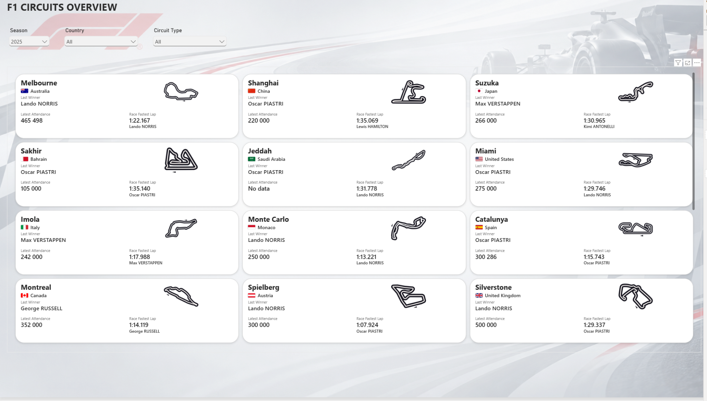
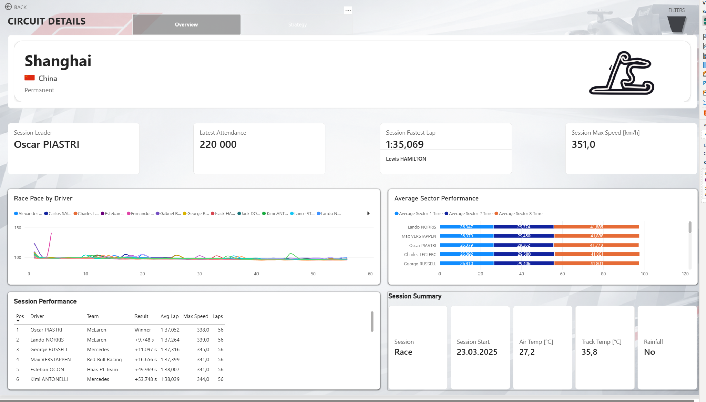
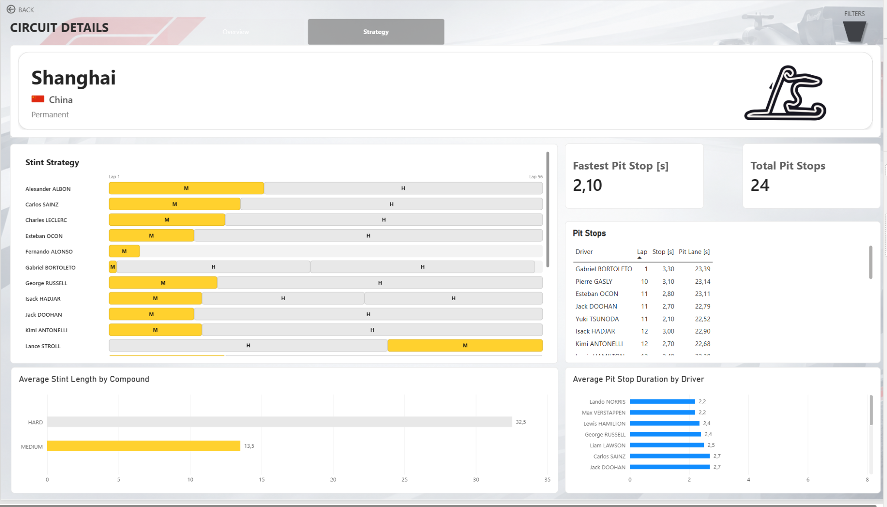
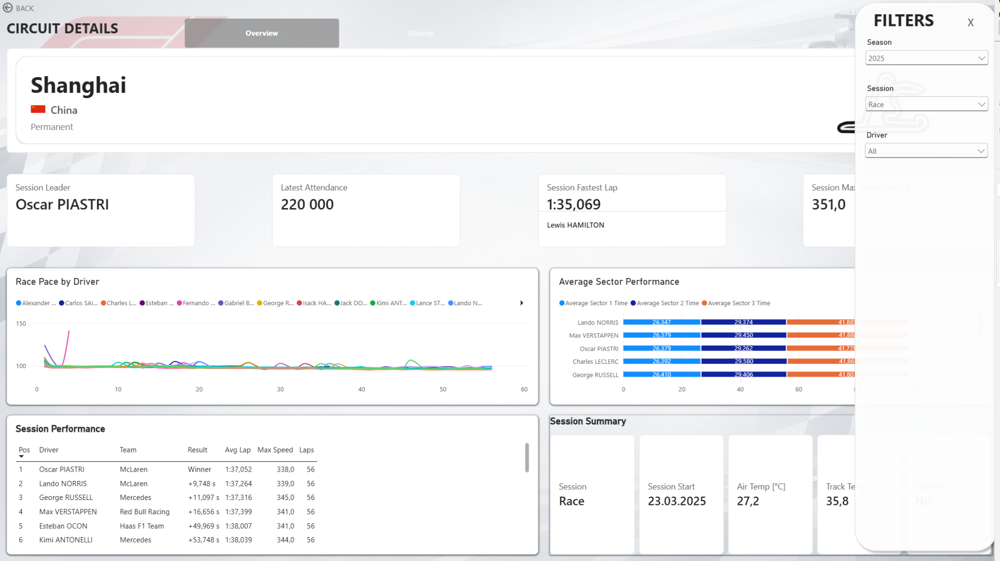
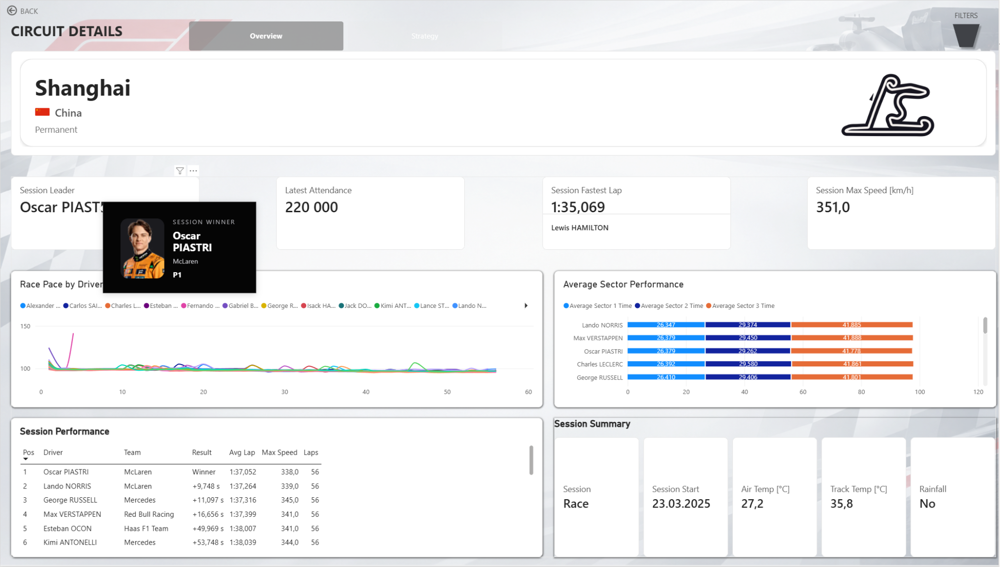

# 🏎️ F1 Data Analytics

**Kompletny projekt Data Engineering / Business Intelligence oparty na danych Formuły 1.**

🇵🇱 [Polska wersja](#polish-version)  
🇬🇧 [English version below](#english-version)




## 🌐 Interaktywny raport / Interactive report

> **Power BI Public Demo**
>
> [▶ Otwórz interaktywny raport Power BI / Open the interactive Power BI report](https://app.powerbi.com/view?r=eyJrIjoiMDc2OGFlMzEtMzBjZS00ZmRhLTljMTItM2JjZTAwY2E3ZDdjIiwidCI6IjY0ZjBkNDRlLWExMmUtNGY0NS1iZDMxLThjMjE1YWUxMzg1YSJ9)

Publiczna wersja raportu została przygotowana specjalnie do prezentacji portfolio i działa w trybie **Import**.  
Główna wersja rozwiązania w repozytorium zachowuje architekturę **SSAS Tabular + Power BI Live Connection**.

The public report was prepared specifically as a portfolio demo and uses an **Import** model.  
The main solution in this repository retains the **SSAS Tabular + Power BI Live Connection** architecture.


---

<a id="polish-version"></a>

# 🇵🇱 Wersja polska

## O projekcie

**F1 Data Analytics** to kompleksowy projekt analityczny obejmujący cały proces przetwarzania danych — od pobrania danych z zewnętrznych API, przez ETL i hurtownię danych, aż po model semantyczny i interaktywny raport Power BI.

Projekt został przygotowany jako portfolio pokazujące praktyczne wykorzystanie technologii Microsoft BI oraz podejścia end-to-end do budowy rozwiązania analitycznego.

Aktualna wersja projektu obejmuje dane dla sezonu **Formula 1 2025**.

## 🎯 Cel projektu

Celem projektu jest zbudowanie kompletnego rozwiązania analitycznego dla danych Formuły 1, które umożliwia analizę m.in.:

- weekendów wyścigowych,
- torów,
- wyników poszczególnych sesji,
- wyników kierowców,
- tempa wyścigowego,
- czasów okrążeń,
- sektorów,
- maksymalnych prędkości,
- strategii opon,
- pit stopów,
- warunków pogodowych,
- komunikatów Race Control,
- frekwencji na torach.

Projekt nie ogranicza się wyłącznie do raportu Power BI — obejmuje również pełny proces pozyskania, walidacji, transformacji i modelowania danych.

## 🏗️ Architektura rozwiązania

```text
OpenF1 API
     │
     ├─────────────────┐
     │                 │
Jolpica API            │
     │                 │
     ▼                 ▼
        Python
   ekstrakcja danych
         │
         ▼
   Pliki CSV / processed
         │
         ▼
        SSIS
         │
         ▼
 SQL Server - Staging
         │
         ▼
 SQL Server Data Warehouse
         │
         ▼
    SSAS Tabular
         │
         ▼
 Power BI Live Connection
         │
         ▼
 Interaktywny raport F1
```

Proces ładowania danych jest dodatkowo automatyzowany przy użyciu:

```text
SQL Server Agent
        ↓
Master_Load_Staging.dtsx
        ↓
etl.usp_RunDwLoad
        ↓
SSAS Process Full
```

## 🌐 Źródła danych

### OpenF1

Głównym źródłem danych jest **OpenF1 API**.

Wykorzystywane dane obejmują m.in.:

- meetings,
- sessions,
- drivers,
- session results,
- laps,
- stints,
- pit stops,
- race control,
- weather.

### Jolpica

**Jolpica API** uzupełnia dane w miejscach, w których są potrzebne dodatkowe informacje, m.in. dotyczące pól startowych.

### Attendance

Dane dotyczące frekwencji przechowywane są jako osobny dataset w warstwie `processed`.

## 🐍 Warstwa Python

Skrypty Python odpowiadają za pobieranie danych z API oraz zapis danych do plików CSV.

```text
src/
├── extract_meetings.py
├── extract_sessions.py
├── extract_drivers.py
├── extract_session_results.py
├── extract_laps.py
├── extract_stints.py
├── extract_pit_stops.py
├── extract_race_control.py
├── extract_weather.py
├── extract_starting_grid.py
└── openf1_client.py
```

Dane wynikowe zapisywane są w:

```text
data/processed/
```

Przykładowe pliki:

```text
meetings_2025.csv
sessions_2025.csv
drivers_2025.csv
session_results_2025.csv
laps_2025.csv
stints_2025.csv
pit_stops_2025.csv
race_control_2025.csv
weather_2025.csv
starting_grid_2025.csv
attendance_2025.csv
```

`SessionResults` jest wspólnym źródłem oficjalnych wyników dla różnych typów sesji.

## 🔄 SSIS

Warstwa SSIS odpowiada za ładowanie danych z plików CSV do tabel stagingowych SQL Server.

Proces oparty jest na pakiecie nadrzędnym `Master_Load_Staging.dtsx` oraz zestawie pakietów odpowiedzialnych za poszczególne datasety.

Konfiguracja ładowania przechowywana jest w tabeli `etl.LoadConfig`, dzięki czemu master package jest sterowany konfiguracją.

Staging działa w modelu **full refresh**:

```text
TRUNCATE TABLE
      ↓
Load current dataset
```

## 🗄️ SQL Server Data Warehouse

Dane ze stagingu są transformowane do modelu wymiarowego.

### Tabele faktów

```text
FactSessionResult
FactLap
FactStint
FactPitStop
FactRaceControl
FactWeather
FactAttendance
```

### Tabele wymiarów

```text
DimSeason
DimRaceWeekend
DimSession
DimSessionType
DimCircuit
DimCountry
DimDriver
DimTeam
DimTeamColour
DimFlag
DimRaceControlCategory
```

Centralną tabelą wyników sesji jest `FactSessionResult`, która przechowuje oficjalne wyniki kierowców dla sesji wyścigowych, kwalifikacyjnych, sprintów i treningów.

## ✅ Walidacja danych

Procedury ładujące hurtownię zawierają kontrole jakości danych, obejmujące m.in.:

- duplikaty rekordów,
- brakujące mapowania do wymiarów,
- nieprawidłowe wartości,
- brakujące powiązania kierowca–sesja,
- osierocone rekordy źródłowe,
- zgodność liczby rekordów przed i po transformacji.

Projekt zachowuje braki wynikające ze źródła zamiast generować sztuczne wartości.

## 📋 Logowanie ETL

Proces ładowania hurtowni jest logowany w dedykowanych tabelach ETL:

```text
etl.DwLoadRun
etl.DwLoadStepRun
etl.LoadConfig
etl.PackageRun
etl.TaskRun
etl.vw_DwLoadHistory
```

Pozwala to analizować historię uruchomień, status poszczególnych kroków oraz ewentualne błędy.

## 🧠 SSAS Tabular

Warstwa semantyczna została zbudowana w **SQL Server Analysis Services Tabular**.

Główna ścieżka relacji:

```text
DimSeason
    ↓
DimRaceWeekend
    ↓
DimSession
    ↓
Session Facts
```

Model zawiera m.in. miary:

```text
Official Session Leader
Official Session Result
Official Session Performance Result
Fastest Lap Time
Fastest Lap Driver
Max Speed Trap
Average Lap Time
Pit Stop Count
Fastest Pit Stop Time
Session Rainfall Status
Latest Weekend Attendance
```

Miary zostały uporządkowane w folderach tematycznych, m.in. `Circuit`, `Session`, `Pit Stops`, `Attendance` i `Laps`.

Power BI korzysta z modelu przez **Live Connection**.

> **Uwaga dotycząca wersji publicznej:** interaktywny raport udostępniony przez `Publish to web` korzysta z osobnej wersji demonstracyjnej w trybie **Import**. Została ona utworzona wyłącznie po to, aby raport mógł być publicznie testowany w przeglądarce bez dostępu do lokalnej instancji SSAS. Główna architektura projektu nadal wykorzystuje SSAS Tabular i Live Connection.

# 📊 Power BI Report

## Live demo

Publiczna wersja raportu jest dostępna bez logowania w przeglądarce:

[▶ Otwórz interaktywny raport Power BI](https://app.powerbi.com/view?r=eyJrIjoiMDc2OGFlMzEtMzBjZS00ZmRhLTljMTItM2JjZTAwY2E3ZDdjIiwidCI6IjY0ZjBkNDRlLWExMmUtNGY0NS1iZDMxLThjMjE1YWUxMzg1YSJ9)

Demo umożliwia korzystanie z filtrów, nawigacji, widoków szczegółowych, analizy strategii oraz interaktywnych tooltipów.


## F1 Circuits Overview

Pierwsza strona raportu prezentuje przegląd torów oraz najważniejsze informacje dotyczące ostatniego weekendu wyścigowego.

Użytkownik może filtrować dane m.in. według sezonu, kraju oraz typu toru.


## Circuit Details

Widok szczegółowy toru prezentuje m.in.:

- zwycięzcę sesji,
- frekwencję,
- najszybsze okrążenie,
- maksymalną prędkość,
- tempo kierowców,
- średnie czasy sektorów,
- klasyfikację sesji,
- warunki pogodowe.



## Strategy

Zakładka Strategy umożliwia analizę:

- stintów,
- wykorzystanych mieszanek,
- długości stintów,
- pit stopów,
- średniego czasu pit stopu,
- liczby pit stopów.



## Interaktywne filtrowanie

Raport posiada panel filtrów umożliwiający analizę danych według sezonu, sesji i kierowcy.



## Interaktywny tooltip kierowcy

Po najechaniu na zwycięzcę sesji wyświetlana jest karta kierowcy zawierająca zdjęcie, imię i nazwisko, zespół oraz pozycję w sesji.



## ⚙️ Automatyzacja

Pełny pipeline może być uruchamiany przy użyciu SQL Server Agent.

Job `F1Analytics - Full Load` wykonuje trzy główne kroki:

```text
01 - Load Staging
        ↓
02 - Load Data Warehouse
        ↓
03 - Process SSAS Model
```

## 🧰 Technologie

| Warstwa | Technologia |
|---|---|
| Data extraction | Python |
| Data processing | pandas |
| API | OpenF1, Jolpica |
| Intermediate storage | CSV |
| ETL | SSIS |
| Database | Microsoft SQL Server |
| Data Warehouse | T-SQL |
| Semantic Layer | SSAS Tabular |
| Measures | DAX |
| Reporting | Power BI |
| Public demo | Power BI Service / Publish to web |
| Orchestration | SQL Server Agent |
| Deployment | SSISDB |
| Version Control | Git / GitHub |

## 📁 Struktura repozytorium

```text
f1-data-analytics_by_MS/
│
├── data/
│   └── processed/
├── docs/
│   └── images/
├── src/
├── sql/
├── ssis/
│   └── F1Analytics_SSIS/
├── ssas/
│   └── F1Analytics_Tabular/
├── powerbi/
│   ├── F1Analytics_Report.pbix
│   └── F1Analytics_PublicDemo.pbix
└── README.md
```

## 🚀 Dalszy rozwój

### Obsługa kolejnych sezonów

Rozszerzenie pipeline'u o kolejne sezony i możliwość wykonywania analiz historycznych.

### Rozszerzenie danych o kierowcach i zespołach

Dodanie dodatkowych danych opisowych, np. narodowości kierowcy, kraju oraz dodatkowych informacji o zespołach i kierowcach.

### Migracja do Azure / Microsoft Fabric

Migracja lokalnej architektury do środowiska chmurowego, np. przy użyciu:

```text
Azure SQL
Azure Data Factory
Microsoft Fabric
OneLake
Fabric Data Warehouse
Fabric Semantic Model
Power BI Service
```

### Automatyczne testy danych

Dodanie testów jednostkowych i integracyjnych dla procesów ekstrakcji i ETL.

Testy powinny sprawdzać m.in.:

- zmianę liczby pobieranych rekordów,
- nieoczekiwany spadek wolumenu danych,
- wartości NULL w kluczowych kolumnach,
- unikalność danych na oczekiwanym poziomie granularności,
- kompletność mapowań,
- poprawność zakresów wartości.

### Monitoring wolumenu danych

Porównywanie liczby pobranych rekordów pomiędzy kolejnymi uruchomieniami pipeline'u.

### Rozbudowa monitoringu pipeline'u

Rozszerzenie logowania oraz automatycznych kontroli procesu ładowania.

## 💡 Zakres kompetencji pokazany w projekcie

Projekt prezentuje praktyczne wykorzystanie:

- REST API,
- Python,
- pandas,
- SQL Server,
- T-SQL,
- dimensional modelling,
- SSIS,
- SSISDB,
- SQL Server Agent,
- ETL logging,
- data quality validation,
- SSAS Tabular,
- DAX,
- Power BI,
- Live Connection,
- Power BI Service / Publish to web,
- data visualization,
- Git / GitHub.

## 📌 Status projektu

Aktualny pipeline:

```text
OpenF1 / Jolpica
        ↓
      Python
        ↓
       CSV
        ↓
      SSIS
        ↓
 SQL Server Staging
        ↓
 Data Warehouse
        ↓
   SSAS Tabular
        ↓
     Power BI
```

jest działającym rozwiązaniem end-to-end dla sezonu **2025**.

Dodatkowo projekt posiada publiczną wersję demonstracyjną Power BI działającą w przeglądarce. Wersja publiczna korzysta z modelu Import, aby uniezależnić demo od lokalnego SQL Server i SSAS.

## ℹ️ Informacja

Formula 1 oraz powiązane znaki towarowe należą do ich właścicieli. Projekt jest niezależnym projektem portfolio i nie jest powiązany z Formula 1.

## 👤 Autor

**Marcin Sikora**

Projekt portfolio Data Analytics / Business Intelligence.

---

<a id="english-version"></a>

# 🇬🇧 English Version

🇵🇱 [Polish version above](#polish-version)

## About the project

**F1 Data Analytics** is an end-to-end Data Engineering and Business Intelligence project covering the complete analytics lifecycle — from external API ingestion, through ETL and dimensional modelling, to a semantic model and an interactive Power BI report.

The project was created as a portfolio solution demonstrating practical experience with the Microsoft BI ecosystem and end-to-end analytics architecture.

The current implementation focuses on the **2025 Formula 1 season**.

## 🎯 Project goal

The goal is to build a complete Formula 1 analytics platform supporting analysis of:

- race weekends,
- circuits,
- session results,
- driver performance,
- race pace,
- lap times,
- sector performance,
- maximum speeds,
- tyre strategies,
- pit stops,
- weather conditions,
- Race Control events,
- circuit attendance.

The project goes beyond dashboard development and includes the complete data ingestion, validation, transformation and modelling process.

## 🏗️ Solution architecture

```text
OpenF1 API
     │
     ├─────────────────┐
     │                 │
Jolpica API            │
     │                 │
     ▼                 ▼
        Python
    Data Extraction
         │
         ▼
   Processed CSV files
         │
         ▼
        SSIS
         │
         ▼
 SQL Server - Staging
         │
         ▼
 SQL Server Data Warehouse
         │
         ▼
    SSAS Tabular
         │
         ▼
 Power BI Live Connection
         │
         ▼
 Interactive F1 Report
```

The loading process can also be automated using:

```text
SQL Server Agent
        ↓
Master_Load_Staging.dtsx
        ↓
etl.usp_RunDwLoad
        ↓
SSAS Process Full
```

## 🌐 Data sources

### OpenF1

The main data source is the **OpenF1 API**.

The project uses data including:

- meetings,
- sessions,
- drivers,
- session results,
- laps,
- stints,
- pit stops,
- race control,
- weather.

### Jolpica

The **Jolpica API** complements the main source where additional information is required, including starting grid data.

### Attendance

Attendance information is maintained as a separate processed dataset.

## 🐍 Python layer

Python scripts retrieve data from the APIs and generate CSV files used by the ETL process.

```text
src/
├── extract_meetings.py
├── extract_sessions.py
├── extract_drivers.py
├── extract_session_results.py
├── extract_laps.py
├── extract_stints.py
├── extract_pit_stops.py
├── extract_race_control.py
├── extract_weather.py
├── extract_starting_grid.py
└── openf1_client.py
```

Processed datasets are stored in `data/processed/`.

`SessionResults` provides a unified source of official session results across different session types.

## 🔄 SSIS

SSIS loads processed CSV files into the SQL Server staging layer.

The process is controlled by `Master_Load_Staging.dtsx` and dataset-specific child packages.

The loading configuration is stored in `etl.LoadConfig`, which keeps the master package configuration-driven.

The staging layer follows a **full refresh** approach:

```text
TRUNCATE TABLE
      ↓
Load current dataset
```

## 🗄️ SQL Server Data Warehouse

Data from staging is transformed into a dimensional warehouse.

### Fact tables

```text
FactSessionResult
FactLap
FactStint
FactPitStop
FactRaceControl
FactWeather
FactAttendance
```

### Dimension tables

```text
DimSeason
DimRaceWeekend
DimSession
DimSessionType
DimCircuit
DimCountry
DimDriver
DimTeam
DimTeamColour
DimFlag
DimRaceControlCategory
```

`FactSessionResult` acts as the central source of official driver results across race, qualifying, sprint and practice sessions.

## ✅ Data validation

Warehouse loading procedures validate:

- duplicate records,
- missing dimension mappings,
- invalid values,
- missing driver/session mappings,
- orphan source records,
- row-count consistency before and after transformations.

Missing values originating from the source are preserved rather than artificially generated.

## 📋 ETL logging

Warehouse loads are tracked using dedicated ETL tables:

```text
etl.DwLoadRun
etl.DwLoadStepRun
etl.LoadConfig
etl.PackageRun
etl.TaskRun
etl.vw_DwLoadHistory
```

This provides visibility into execution history, individual load steps and failures.

## 🧠 SSAS Tabular

The semantic layer is implemented using **SQL Server Analysis Services Tabular**.

The main relationship path is:

```text
DimSeason
    ↓
DimRaceWeekend
    ↓
DimSession
    ↓
Session Facts
```

The model includes reusable measures for session results, lap timing, speed, pit stops, weather and attendance.

Measures are organized into logical display folders such as `Circuit`, `Session`, `Pit Stops`, `Attendance` and `Laps`.

Power BI connects to the semantic model using a **Live Connection**.

> **Public demo note:** the interactive report shared through `Publish to web` uses a separate **Import** version created specifically for browser-based portfolio access without requiring connectivity to the local SSAS instance. The main project architecture still uses SSAS Tabular and Live Connection.

# 📊 Power BI Report

## Live demo

A public interactive version of the report is available in the browser without sign-in:

[▶ Open the interactive Power BI report](https://app.powerbi.com/view?r=eyJrIjoiMDc2OGFlMzEtMzBjZS00ZmRhLTljMTItM2JjZTAwY2E3ZDdjIiwidCI6IjY0ZjBkNDRlLWExMmUtNGY0NS1iZDMxLThjMjE1YWUxMzg1YSJ9)

The demo supports filtering, navigation, detailed circuit views, strategy analysis and interactive driver tooltips.


## F1 Circuits Overview

The landing page provides an overview of Formula 1 circuits and key information from the latest race weekend.


## Circuit Details

The detailed circuit view includes session winner, attendance, fastest lap, maximum speed, race pace, sector performance, official classification and weather conditions.


## Strategy

The Strategy page provides analysis of tyre stints, compounds, stint lengths and pit stop activity.


## Interactive filtering

The report includes a dedicated filter panel supporting analysis by season, session and driver.


## Interactive driver tooltip

Hovering over the session winner displays a contextual driver card containing the driver headshot, name, team and finishing position.


## ⚙️ Automation

The complete pipeline can be executed using SQL Server Agent.

The `F1Analytics - Full Load` job contains three main steps:

```text
01 - Load Staging
        ↓
02 - Load Data Warehouse
        ↓
03 - Process SSAS Model
```

## 🧰 Technology stack

| Layer | Technology |
|---|---|
| Data extraction | Python |
| Data processing | pandas |
| APIs | OpenF1, Jolpica |
| Intermediate storage | CSV |
| ETL | SSIS |
| Database | Microsoft SQL Server |
| Data Warehouse | T-SQL |
| Semantic Layer | SSAS Tabular |
| Measures | DAX |
| Reporting | Power BI |
| Orchestration | SQL Server Agent |
| Deployment | SSISDB |
| Version Control | Git / GitHub |

## 📁 Repository structure

```text
f1-data-analytics_by_MS/
│
├── data/
│   └── processed/
├── docs/
│   └── images/
├── src/
├── sql/
├── ssis/
│   └── F1Analytics_SSIS/
├── ssas/
│   └── F1Analytics_Tabular/
├── powerbi/
│   └── F1Analytics_Report.pbix
└── README.md
```

## 🚀 Roadmap

### Multi-season support

Extend the pipeline beyond the 2025 season and introduce historical comparisons.

### Driver and team enrichment

Add driver nationality, country and additional driver/team metadata.

### Azure / Microsoft Fabric migration

A future version may migrate the current local architecture to Azure or Microsoft Fabric.

Potential technologies include Azure SQL, Azure Data Factory, Microsoft Fabric, OneLake, Fabric Data Warehouse, Fabric Semantic Model and Power BI Service.

### Automated data testing

Introduce unit and integration tests for extraction and ETL processes.

Tests should validate:

- changes in retrieved row counts,
- unexpected decreases in source data volume,
- unexpected NULL values,
- uniqueness at the expected grain,
- mapping completeness,
- expected value ranges.

### Data volume monitoring

Compare extracted row counts between subsequent pipeline executions to detect incomplete or unusual source responses.

### Pipeline monitoring

Extend logging and automated validation of scheduled data loads.

## 💡 Skills demonstrated

The project demonstrates practical experience with:

- REST APIs,
- Python,
- pandas,
- SQL Server,
- T-SQL,
- dimensional modelling,
- SSIS,
- SSISDB,
- SQL Server Agent,
- ETL logging,
- data quality validation,
- SSAS Tabular,
- DAX,
- Power BI,
- Live Connection,
- data visualization,
- Git / GitHub.

## 📌 Project status

The current pipeline:

```text
OpenF1 / Jolpica
        ↓
      Python
        ↓
       CSV
        ↓
      SSIS
        ↓
 SQL Server Staging
        ↓
 Data Warehouse
        ↓
   SSAS Tabular
        ↓
     Power BI
```

is a working end-to-end analytics solution for the **2025 Formula 1 season**.

The project also includes a public Power BI demo that can be explored directly in a web browser. The public version uses an Import model so the demo does not depend on the local SQL Server and SSAS environment.

## ℹ️ Disclaimer

Formula 1 and related trademarks are the property of their respective owners. This is an independent portfolio project and is not affiliated with Formula 1.

## 👤 Author

**Marcin Sikora**

Data Analytics / Business Intelligence portfolio project.
